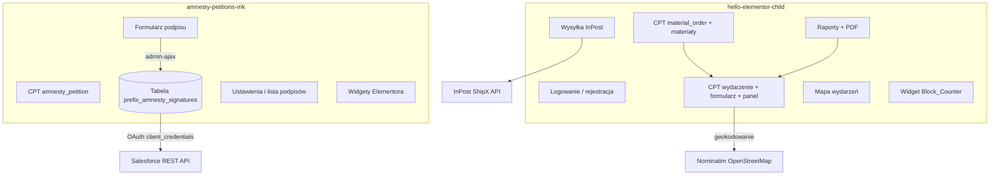

# Architektura i kontrakty

Stan: 2026-10-14, `develop` @ `02ddaac`. Zmiany robocze: [status.md](status.md#zmiany-robocze-niezatwierdzone).

## Zakres

System składa się z motywu potomnego i własnego pluginu działających w jednej instalacji WordPressa. Oba korzystają z Elementora (widgety, edytor stron). Motyw opcjonalnie korzysta z ACF (`get_field()` / `update_field()` z fallbackiem na meta wpisów).

## Punkty wejścia

| Moduł | Plik | Co robi przy ładowaniu |
|---|---|---|
| Motyw | [`functions.php`](../themes/hello-elementor-child/functions.php) | definiuje `MARATON_VERSION`, ładuje [`classes/elementor_controls.php`](../themes/hello-elementor-child/classes/elementor_controls.php), dołącza moduły z `functions/` (brak pliku → `error_log`), tworzy `Maraton\Maraton_Elementor_Extension` |
| Plugin | [`amnesty-petitions.php`](../plugins/amnesty-petitions-mk/amnesty-petitions.php) | definiuje `AMNESTY_PETITIONS_PATH/URL/VERSION`, dołącza moduły `includes/` i `templates/template-tags.php`, rejestruje loader szablonu i zasoby |

`Maraton_Elementor_Extension` ma obecnie pusty konstruktor — nie rejestruje żadnych kontrolek.

## Granice modułów

W HEAD motyw i plugin nie wywołują nawzajem swoich funkcji. Zmiany robocze wprowadzają zależność motywu od pluginu — zobacz [status.md](status.md#zmiany-robocze-niezatwierdzone).

## Główne przepływy

### Podpis petycji

1. Filtr `single_template` wybiera szablon z motywu (`single-amnesty_petition.php`, jeśli istnieje) albo [`templates/single-amnesty_petition.php`](../plugins/amnesty-petitions-mk/templates/single-amnesty_petition.php).
2. Szablon renderuje `[amnesty_petition id="…"]`.
3. [`amnesty-frontend.js`](../plugins/amnesty-petitions-mk/assets/js/amnesty-frontend.js) wysyła `FormData` z `action=submit_amnesty_petition` do `admin-ajax.php`.
4. [`ajax-salesforce.php`](../plugins/amnesty-petitions-mk/includes/ajax-salesforce.php) zapisuje podpis(y) w tabeli i, jeśli petycja ma `_amnesty_petition_topic_name`, synchronizuje kontakt z Salesforce.
5. Po sukcesie frontend pokazuje stan `#thankyou`.

Szczegóły: [amnesty-petitions-mk.md](amnesty-petitions-mk.md#zapis-podpisu).

### Organizator wydarzenia

1. Rejestracja `[event_registration]` lub logowanie `[event_login]` → przekierowanie do `/panel/`.
2. Dodanie wydarzenia `[event_form]` → wpis `wydarzenie` (status `publish`) z geokodowaniem adresu.
3. Panel `[my_events]` → edycja wydarzenia (AJAX), zamówienie materiałów, raport po wydarzeniu, PDF raportu.
4. Zamówienie `[materials_order]` → wpis `material_order` obsługiwany w panelu admina.

Szczegóły: [hello-elementor-child.md](hello-elementor-child.md).

## Kontrakty danych

### Typy wpisów

| CPT | Właściciel | Publiczny | Rola |
|---|---|---|---|
| `amnesty_petition` | plugin, [`cpt-meta.php`](../plugins/amnesty-petitions-mk/includes/cpt-meta.php) | tak, slug `petycja`, archiwum | petycja |
| `wydarzenie` | motyw, [`events-core.php`](../themes/hello-elementor-child/functions/events-core.php) | tak | wydarzenie organizatora (autor = właściciel) |
| `material_order` | motyw, [`events-materials.php`](../themes/hello-elementor-child/functions/events-materials.php) | nie (tylko UI admina) | zamówienie materiałów na wydarzenie |

### Tabela

`$wpdb->prefix . 'amnesty_signatures'` — tworzona przez `dbDelta` w hooku aktywacji pluginu. Schemat: [amnesty-petitions-mk.md](amnesty-petitions-mk.md#tabela-podpisów). Nazwy nie wolno zapisywać na sztywno (prefix zależy od instalacji).

### Endpointy

| Akcja | Typ | Dostęp | Plik |
|---|---|---|---|
| `submit_amnesty_petition` | AJAX | publiczny + zalogowani, nonce `amnesty_sign_petition` | plugin `ajax-salesforce.php` |
| `get_amnesty_map_data` | AJAX | publiczny — **moduł nie jest ładowany** | plugin `ajax-map.php` |
| `get_events_map_data` | AJAX | publiczny, cache transient 1 h | motyw `events-map.php` |
| `get_event_form`, `save_event_form` | AJAX | zalogowany autor wydarzenia | motyw `events-panel.php` |
| `get_report_form`, `save_event_report` | AJAX | zalogowany autor wydarzenia | motyw `events-reports.php` |
| `generate_inpost_label` | AJAX | `manage_options` | motyw `events-shipping-api.php` |
| `download_inpost_label` | `admin-post` | `manage_options` | motyw `events-shipping-api.php` |
| `?download_report=<id>` | `template_redirect` | zalogowany autor, raport złożony | motyw `events-reports.php` |

Formularze logowania, rejestracji, wydarzenia i zamówienia materiałów są obsługiwane przez `template_redirect` (POST na tę samą stronę), nie przez AJAX.

### Shortcode'y

| Shortcode | Plik |
|---|---|
| `[amnesty_petition id]` | plugin `includes/shortcodes.php` |
| `[amnesty_petition_map id]` | plugin `includes/shortcodes.php` |
| `[event_login]`, `[event_registration]` | motyw `functions/events-auth.php` |
| `[event_form]` | motyw `functions/events-form.php` |
| `[events_map]` | motyw `functions/events-map.php` |
| `[my_events]` | motyw `functions/events-panel.php` |
| `[materials_order]` | motyw `functions/events-materials.php` |

### Opcje WordPressa (nazwy, bez wartości)

| Grupa ustawień | Opcje | Właściciel |
|---|---|---|
| `amnesty_global_settings_group` | `amnesty_color_*`, `amnesty_text_*`, `amnesty_thankyou_*`, `amnesty_link_*`, `amnesty_sf_instance_url`, `amnesty_sf_client_id`, `amnesty_sf_client_secret` | plugin `settings.php` |
| `global_materials_group` | `global_mat_{1..3}_title`, `global_mat_{1..3}_url` | motyw `events-materials.php` |
| `shipping_api_settings_group` | `inpost_api_token`, `inpost_org_id`, `inpost_environment`, `shipping_sender_*` | motyw `events-shipping-api.php` |

Opcje `amnesty_sf_client_secret` i `inpost_api_token` są sekretami przechowywanymi w bazie (tabela opcji) jako zwykły tekst.

### Zależności zewnętrzne w runtime

- Salesforce REST API `v58.0` (OAuth `client_credentials`);
- Nominatim OpenStreetMap (geokodowanie adresów wydarzeń);
- Leaflet 1.9.4 z `unpkg.com` (mapy);
- InPost ShipX API (sandbox lub produkcja wg `inpost_environment`).

## Ograniczenia

- Brak testów automatycznych, lintera i CI.
- Część CSS to ręczny CSS (plugin, `style.css` motywu), część to SCSS motywu kompilowany do `dist/`.
- Teksty interfejsu są po polsku, text domainy: `amnesty-petitions` (plugin), `amnestympl` (motyw); plików tłumaczeń brak.
